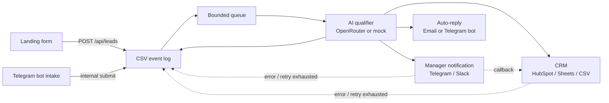
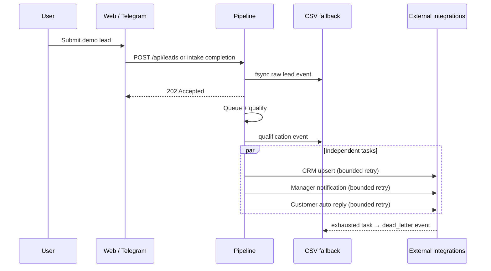

# Architecture

Technical companion to the [README](README.md). The pipeline is a single Go service plus a static landing behind nginx; every external dependency is a pluggable adapter with a demo fallback.

## Pipeline overview



Every stage is best-effort: a failure in one stage must not lose the lead. The lead is durably written to CSV first, then processed asynchronously.

## The life of one lead



## Design decisions and trade-offs

| Decision | Why it fits a demo | Production replacement / limitation |
|---|---|---|
| CSV append-only event log | Lead is fsync-ed before HTTP `202`; inspectable with zero infrastructure | PostgreSQL `leads`/`lead_events` tables with a backup policy; CSV is unfit for concurrent multi-instance access |
| Bounded in-memory Go queue | Simple, memory-capped; queue-full returns a controlled `503` after the CSV write | Postgres outbox + worker, SQS, NATS JetStream or Redis Streams for horizontal scale |
| Mock AI fallback | Demo runs with no OpenRouter key; malformed/timed-out LLM responses degrade safely | Model quality monitoring, prompt review, explicit provider SLAs/limits |
| In-memory rate limiter | Protects a single instance without Redis | Distributed rate limiting and a consistent reverse-proxy/WAF policy |
| CSV dead-letter events | Shows exactly which lead and integration needs replay | Dedicated retry queue, operator replay UI, alerts |

## Integration configuration

Every variable is optional; missing keys degrade to safe demo behaviour.

| Integration | Environment variables | Behaviour without them |
|---|---|---|
| OpenRouter (AI qualification) | `OPENROUTER_API_KEY`, `OPENROUTER_MODEL` | Keyword-based mock qualifier |
| HubSpot CRM | `HUBSPOT_TOKEN` | Google Sheets if configured, else CSV |
| Google Sheets CRM | `SHEETS_WEBHOOK_URL`, `SHEETS_WEBHOOK_SECRET` | CSV |
| Telegram bot + manager cards | `TELEGRAM_BOT_TOKEN`, `TELEGRAM_MANAGER_CHAT_ID` | Notifications to stdout, bot disabled |
| Slack | `SLACK_WEBHOOK_URL`, `SLACK_SIGNING_SECRET` | Slack adapter not registered |
| SMTP auto-reply | `SMTP_HOST`, `SMTP_USER`, `SMTP_PASS`, `SMTP_FROM` | Outgoing email printed to stdout |

CRM selection order: HubSpot → Google Sheets webhook → Google Sheets API → CSV. See [USAGE.md](USAGE.md) (Russian) for step-by-step setup of each integration.

## Reliability details

- Raw lead is persisted before the API acknowledges; qualification and dead-letter events are appended to the same fallback CSV even when a primary CRM is configured, keeping a full recoverable history on disk.
- HubSpot upsert searches deals by `lead_id`, so retries do not duplicate deals; the queue has a hard limit and a graceful shutdown that drains workers and in-flight notifications.
- CORS, trusted proxy CIDRs (`TRUSTED_PROXY_CIDRS`), body/field limits and GDPR-consent are validated server-side.
- Notification retries are bounded and only for transient failures; providers without idempotency keys may still deliver duplicates — exhausted tasks are recorded as `dead_letter:*` events for manual replay.
- If `data/leads.csv` was created by an older version, the service migrates the known legacy schema in place at startup, leaving the original next to it as `leads.csv.pre-consent-migration-<timestamp>.bak`. An unknown or corrupted schema stops the service with an explicit error instead of guessing.

## Observability and recovery

- `GET /healthz` — process liveness.
- `GET /readyz` — additionally verifies the queue accepts work and the CSV fallback is writable; used by the Docker health check.
- `GET /metrics` — Prometheus metrics: accepted/processed leads, processing time, AI fallbacks, integration errors, queue depth, auto-replies. Do not expose port `8081` directly to the internet.

The CSV event log is the recovery source for the demo service:

```bash
./scripts/backup-csv.sh data/leads.csv backups                          # verifiable backup
./scripts/restore-csv.sh backups/leads-YYYYMMDDTHHMMSSZ.csv data/leads.csv
```

Restore deliberately requires explicit paths for both the backup and the target file.

## Testing and CI

```bash
cd pipeline && go test ./...
```

Covered: qualifier JSON parsing and fallback on malformed responses, form and consent validation, the Telegram intake state machine, notification card building, Slack signature verification, and the CRM interface via mocks.

CI (GitHub Actions) runs `gofmt` check, `go vet`, race-detector tests, a Docker Compose smoke test (including an in-place migration of a legacy CSV schema and a real lead submission), and a Trivy config scan. Dependabot watches dependencies.

## Project structure

```
lead-pipeline/
├── landing/                # static HTML landing + nginx config
├── pipeline/               # Go service
│   ├── cmd/pipeline/       # entry point
│   └── pkg/
│       ├── api/            # HTTP, rate limiting, validation
│       ├── autoreply/      # email or Telegram auto-reply
│       ├── crm/            # HubSpot / Sheets / CSV
│       ├── logging/        # slog helpers
│       ├── models/         # Lead and Qualification
│       ├── notify/         # Telegram and Slack adapters
│       ├── qualifier/      # OpenRouter and mock qualifier
│       ├── queue/          # internal queue with a worker
│       └── tgbot/          # Telegram intake via long polling
├── data/                   # fallback CSV with leads
├── docker-compose.yml
├── Makefile
└── .env.example
```

Development without Docker:

```bash
cd pipeline
go run ./cmd/pipeline    # listens on :8081, uses ../data/leads.csv
```
