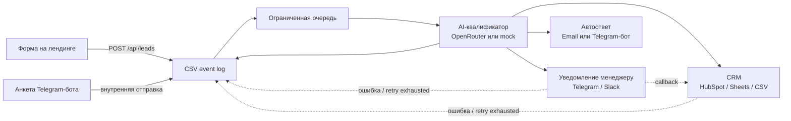
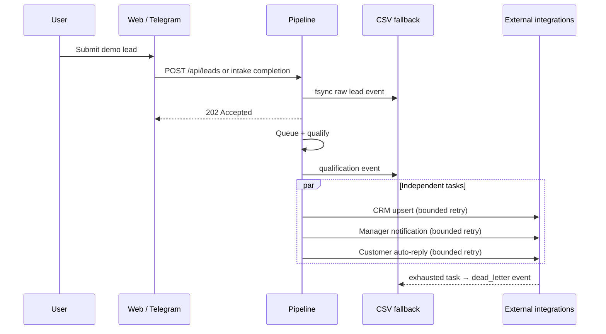

# Anker Relocation — конвейер обработки лидов

[English overview](README.en.md)

Автоматизация быстрого ответа на обращения для вымышленного берлинского релокейт-агентства, помогающего экспатам с визами, жильём и регистрацией по месту жительства (Anmeldung). У системы два входа — лендинг и Telegram-бот; далее лид квалифицируется AI, записывается в CRM и отправляется менеджеру с интерактивными кнопками.

Проект целиком запускается в **демо-режиме без API-ключей**. Чтобы включить реальные интеграции, достаточно постепенно заполнить соответствующие переменные в `.env`.

## Конвейер



Каждый этап выполняется в режиме best effort: ошибка на одном этапе не должна привести к потере лида. Лид сначала записывается в CSV, а затем обрабатывается асинхронно.

## Быстрый старт за 5 минут

```bash
cd lead-pipeline
cp .env.example .env
make up             # docker compose: лендинг (nginx :8080) + pipeline (:8081)
make demo-lead      # отправить реалистичный тестовый лид с лендинга
make demo-lead-hot  # лид с подписанным оффером и переездом через 6 недель
```

Затем откройте [http://localhost:8080](http://localhost:8080) и отправьте форму. В `docker compose logs -f pipeline` будут видны вердикт квалификатора, запись в `data/leads.csv` и карточка уведомления, выведенная в stdout.

Запуск для разработки без Docker:

```bash
cd pipeline
go run ./cmd/pipeline    # слушает :8081, использует ../data/leads.csv
```

## Интеграции

| Интеграция | Переменные окружения | Поведение без настройки |
|---|---|---|
| OpenRouter (AI-квалификация) | `OPENROUTER_API_KEY`, `OPENROUTER_MODEL` | Используется mock-квалификатор по ключевым словам |
| HubSpot CRM | `HUBSPOT_TOKEN` | Используются Google Sheets, если они настроены; иначе CSV |
| Google Sheets CRM | `SHEETS_SPREADSHEET_ID`, `SHEETS_SA_JSON` | Используется CSV |
| Telegram-бот и уведомления менеджеру | `TELEGRAM_BOT_TOKEN`, `TELEGRAM_MANAGER_CHAT_ID` | Уведомления выводятся в stdout, бот выключен |
| Slack | `SLACK_WEBHOOK_URL`, `SLACK_SIGNING_SECRET` | Slack-адаптер не регистрируется |
| SMTP-автоответ | `SMTP_HOST`, `SMTP_USER`, `SMTP_PASS`, `SMTP_FROM` | Исходящее письмо выводится в stdout |

Настраивайте только те интеграции, ключи для которых уже есть: остальные компоненты должны продолжать работать в деградированном режиме.

## Архитектурные решения и компромиссы

| Решение | Почему подходит для demo | Production-замена / ограничение |
|---|---|---|
| CSV append-only event log | Лид fsync-записывается до HTTP `202`, его можно открыть без инфраструктуры | PostgreSQL с таблицами `leads`/`lead_events` и backup policy; CSV не подходит для конкурентного multi-instance поиска |
| Буферизированная Go-очередь | Проста и ограничена по памяти; queue-full возвращает контролируемый `503` после записи в CSV | Postgres outbox + worker, SQS, NATS JetStream или Redis Streams для горизонтального масштаба |
| Mock AI fallback | Демо работает без ключа OpenRouter | Мониторинг качества модели, ревью prompt и явные SLA/лимиты провайдера |
| In-memory rate limiter | Защищает один экземпляр без Redis | Distributed rate limit и согласованная политика reverse proxy/WAF |
| CSV dead-letter events | Видно, какой lead и интеграция нуждаются в повторной обработке | Отдельная retry-очередь, UI/replay command и алерты |

### Путь одного лида



## Что сделано для production-minded demo

- Raw lead сохраняется до подтверждения API; актуальная qualification и dead-letter события остаются в fallback CSV.
- HubSpot upsert ищет сделку по `lead_id`; очередь имеет лимит и graceful shutdown.
- CORS, trusted proxy IP handling, body/field limits и согласие на обработку данных проверяются на сервере.
- `/readyz`, `/metrics`, JSON logs, non-root pipeline container, resource limits и проверяемый backup/restore уже есть.
- CI запускает форматирование, vet, race tests, Compose smoke test и Trivy config scan.

## Известные ограничения

- Это **demo case study**, не публичная CRM: без HTTPS, назначенного data controller и процесса удаления данных нельзя заявлять GDPR compliance.
- Повторная доставка уведомления может дать дубль у провайдера, который не поддерживает idempotency key; событие при исчерпанных ретраях остаётся в CSV для ручной обработки.
- Google Sheets — append-only экспорт, а не источник истины для статусов.
- Публикация контейнерного образа, Alertmanager rules, видео/GIF и скриншоты безопасного демо ещё не подготовлены.

## Сценарий использования

> «Медианное время первого ответа: 4 часа → 30 секунд. 40% обращений автоматически помечаются как неготовые к покупке или спам, поэтому отдел продаж видит только лиды, с которыми стоит связаться. Обработка данных возможна только после согласия пользователя».

## Структура проекта

```
lead-pipeline/
├── landing/                # статический HTML-лендинг + Tailwind CDN
├── pipeline/               # Go-сервис
│   ├── cmd/pipeline/       # точка входа
│   └── pkg/
│       ├── api/            # HTTP, rate limit и валидация
│       ├── autoreply/      # email- или Telegram-автоответ
│       ├── crm/            # HubSpot / Sheets / CSV
│       ├── logging/        # вспомогательные функции slog
│       ├── models/         # Lead и Qualification
│       ├── notify/         # адаптеры Telegram и Slack
│       ├── qualifier/      # OpenRouter и mock-квалификатор
│       ├── queue/          # внутренняя очередь с воркером
│       └── tgbot/          # анкета в Telegram через long polling
├── data/                   # резервный CSV с лидами
├── docker-compose.yml
├── Makefile
└── .env.example
```

## Тесты

```bash
cd pipeline && go test ./...
```

Покрыты: разбор JSON от квалификатора и fallback при некорректном ответе, валидация формы и согласия на обработку данных, state machine Telegram-анкеты, построение карточек уведомлений, проверка подписи Slack и интерфейс CRM через mock.

Подробное русскоязычное руководство по запуску и настройке находится в [USAGE.md](USAGE.md).

## Наблюдаемость и восстановление

- `GET /healthz` подтверждает, что HTTP-процесс работает.
- `GET /readyz` дополнительно проверяет, что очередь принимает лиды и CSV fallback доступен для записи. Docker health check использует этот endpoint.
- `GET /metrics` отдаёт Prometheus-метрики принятых и обработанных лидов, времени обработки, AI fallback, ошибок интеграций, очереди и автоответов. Не публикуйте порт `8081` напрямую в интернет.

CSV event log — источник восстановления демо-сервиса. Создайте проверяемую копию:

```bash
./scripts/backup-csv.sh data/leads.csv backups
```

Восстановление намеренно требует явных путей к резервной копии и рабочему файлу:

```bash
./scripts/restore-csv.sh backups/leads-YYYYMMDDTHHMMSSZ.csv data/leads.csv
```
