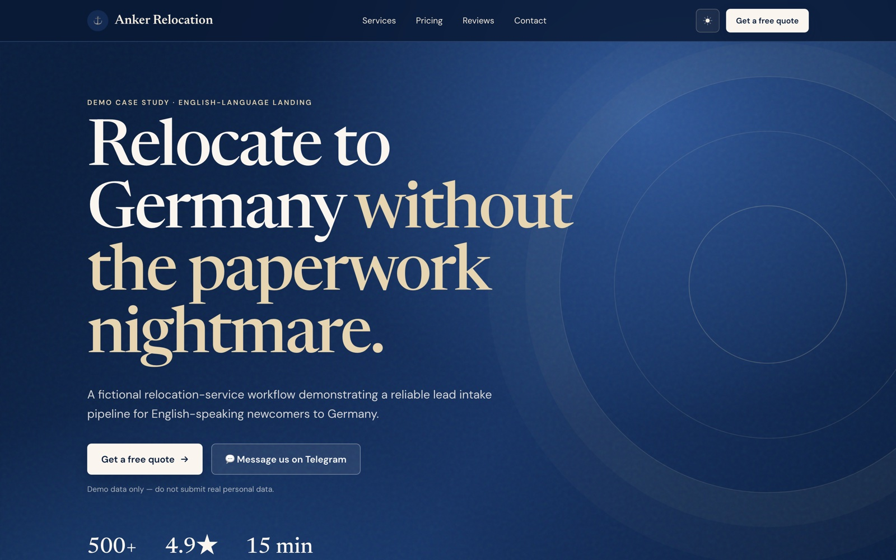
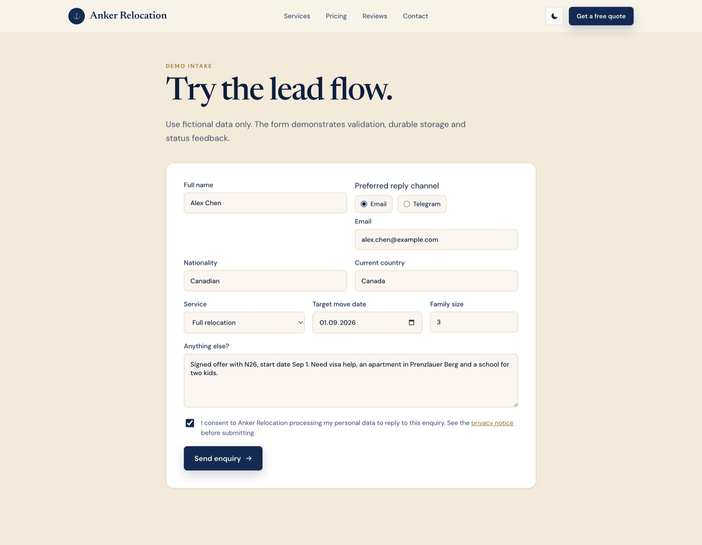

# Anker Relocation — AI-конвейер обработки лидов (demo case study)

[English version](README.md) · [Архитектура (EN)](ARCHITECTURE.md) · [Руководство по запуску и настройке](USAGE.md)

**Ответ на заявку за ~30 секунд вместо 4 часов.** Полноценная работающая система обработки лидов на примере вымышленного берлинского релокейт-агентства: лендинг и Telegram-бот принимают заявки, AI квалифицирует каждую, запись попадает в CRM, менеджер получает карточку с кнопками действий, а клиент — мгновенный персональный ответ.



## Какую проблему это решает

Бизнес в сфере услуг теряет сделки в промежутке между «заявка отправлена» и «менеджер ответил». Заявки приходят ночью и в выходные, заметная часть — спам или «просто интересуюсь», а пока менеджер добирается до хороших, клиент уже записался на звонок к конкуренту.

Конвейер закрывает этот разрыв:

- **Ответ за секунды, а не часы.** Клиент получает персональный ответ с реалистичной вилкой цены сразу после отправки формы — на email или в Telegram.
- **Продажи видят только стоящие лиды.** AI помечает каждую заявку как *hot / warm / cold / spam* с оценкой срочности — никто не тратит утро на разбор общего ящика.
- **Ничего не теряется.** Лид записывается на диск *до того*, как сайт подтвердит приём. Если CRM, AI-провайдер или Telegram недоступны — лид цел, а сбой зафиксирован для повторной обработки.

> Целевой сценарий: медианное время первого ответа **4 часа → 30 секунд**; ~40% обращений автоматически помечаются как спам или «не готов» и не отвлекают отдел продаж. Персональные данные обрабатываются только после явного согласия — проверка на сервере.

## Путь одного лида

1. Посетитель отправляет форму (или проходит анкету Telegram-бота):



2. Лид fsync-записывается в append-only журнал событий, посетитель видит «принято» — всё дальнейшее выполняется асинхронно и с ретраями.

3. AI (OpenRouter, с детерминированным keyword-fallback) классифицирует заявку. Реальный лог этого демо-лида:

```json
{"level":"INFO","msg":"qualified","lead_id":"ld_3a0f62e2a21bed7d","source":"web","category":"hot","urgency":5,"fallback":false}
```

4. В Telegram (или Slack) менеджера приходит карточка с кнопками — **Claim** и **Mark spam** обновляют CRM, не открывая её:

```
🔥  Hot new lead: Alex Chen (Canadian)
    Service: full_relocation
    Move date: 2026-09-01
    Family size: 3
    Source: web
    Summary: Signed job offer or concrete relocation timeline — call within the hour.
    Estimate: €3,750 – €9,000

    [ ✅ Claim ]   [ 🗑 Mark spam ]   [ 💬 Contact ]
```

5. CRM (HubSpot или Google Sheets) получает сделку с той же оценкой и резюме.

6. Клиент получает мгновенный ответ под свою ситуацию:

> Hi Alex, thanks for reaching out — this looks like exactly what we handle every week. For your situation the full package usually lands between €3,750 and €9,000. I can hop on a 15-minute call today; what timezone are you in?

## Запустите сами за 5 минут

API-ключи не нужны: без них конвейер использует mock-квалификатор, CSV-хранилище и уведомления в stdout — весь поток виден локально:

```bash
cd lead-pipeline
cp .env.example .env
make up             # docker compose: лендинг на :8080, pipeline на :8081
make demo-lead      # отправить реалистичный тестовый лид
make demo-lead-hot  # лид с подписанным оффером и переездом через 6 недель
```

Откройте <http://localhost:8080>, отправьте форму и посмотрите в `docker compose logs -f pipeline` вердикт квалификатора, запись в CRM и карточку менеджера. Используйте только вымышленные данные.

## Интеграции

Каждая интеграция включается, когда её ключи появляются в `.env`; всё остальное продолжает работать и без неё.

| Интеграция | Что даёт | Без ключей |
|---|---|---|
| OpenRouter (любая LLM) | Настоящая AI-квалификация и черновик ответа | Mock-квалификатор по ключевым словам |
| HubSpot | Сделки в вашей воронке продаж | Google Sheets, затем CSV |
| Google Sheets | Лёгкая CRM, знакомая команде | CSV-журнал событий |
| Telegram | Бот-анкета + карточки менеджеру с кнопками | Карточки в логах |
| Slack | Уведомления менеджеру в канал | — |
| SMTP | Мгновенные автоответы клиентам на email | Ответ в логах |

## Скучные вещи, сделанные как надо

Демо небольшое, но собрано так, как строят production-системы:

- Write-ahead журнал событий: лид на диске до HTTP 202; сбои CRM/уведомлений/автоответа оставляют dead-letter события для повторной обработки.
- Ограниченная очередь с backpressure (контролируемый 503 вместо тихой потери), graceful shutdown с дренажем текущей работы.
- Серверная валидация, проверка согласия на обработку данных, rate limiting, CORS и trusted-proxy.
- `/healthz`, `/readyz`, Prometheus `/metrics`, JSON-логи, non-root контейнер, CI с race-тестами, smoke-тест Docker Compose и скан конфигурации на уязвимости.
- Автоматическая миграция старых схем данных на диске с timestamped-бэкапами и проверяемыми скриптами backup/restore.

Детали, диаграммы и компромиссы: [ARCHITECTURE.md](ARCHITECTURE.md).

## Адаптация под ваш бизнес

Релокация — просто пример. Тот же конвейер подходит любому бизнесу, живущему на входящих заявках: стоматологии и клиники, агентства недвижимости и аренды, автосервисы, юридические и миграционные консультанты, B2B-услуги. Меняются поля формы, промпт квалификации и шаблоны ответов; ядро надёжности остаётся тем же. AI-провайдер, CRM и каналы уведомлений — подключаемые адаптеры.

## Честные ограничения

Это **demo case study**, а не готовый хостируемый продукт:

- Компания, отзывы, цены и метрики на лендинге явно помечены как вымышленные; цифры времени ответа выше — целевой сценарий, а не production-замеры.
- Не GDPR-compliant как есть: реальному деплою нужны HTTPS, назначенный data controller и процессы хранения/удаления данных.
- Google Sheets — лёгкая одноэкземплярная CRM, а не замена полноценной multi-user CRM; часть провайдеров уведомлений может дать дубль при ретрае.
- Демо-видео в планах; скриншоты выше сняты с работающего демо.

## Технологии

Go 1.22 (только стандартная библиотека — `net/http`, `slog`, без фреймворков) · статический HTML/CSS/JS лендинг · nginx · Docker Compose · OpenRouter · API HubSpot, Google Sheets и Telegram · GitHub Actions CI.

```bash
cd pipeline && go test ./...   # race-тесты гоняются в CI на каждый push
```

Структура проекта, диаграммы и проектные решения: [ARCHITECTURE.md](ARCHITECTURE.md). Русскоязычное руководство по запуску и настройке: [USAGE.md](USAGE.md).
